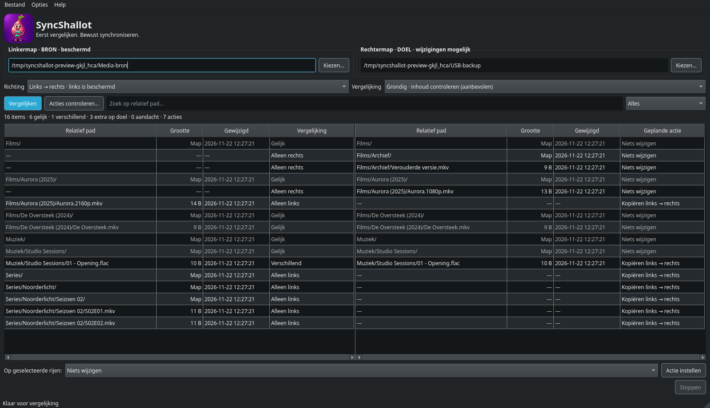

# SyncShallot

De gemakkelijkste manier om je backup schijven te synchroniseren, zonder onnodige bestanden op je backups te laten staan!

Vervang je een bestand op je hoofdschijf, dan blijft de oude versie vaak op je back-up staan.
SyncShallot laat zien wat er ontbreekt, wat is veranderd en wat alleen nog op de back-up staat.
Je kiest zelf wat je bijwerkt, apart zet of verwijdert. De bron blijft standaard beschermd.

De huidige versie is **1.1.0**.

## Wat het kan

**Vergelijken**

- Twee mappen vergelijken, inclusief alle submappen en verborgen bestanden.
- Werken met mappen op je computer, USB-schijven en gekoppelde netwerkshares.
- Snel vergelijken op grootte en datum, of grondig de bestandsinhoud controleren voor meer zekerheid.
- Bestanden naast elkaar bekijken en zoeken of filteren op verschillen, extra doelbestanden en conflicten.

**Synchroniseren**

- Nieuwe en gewijzigde bestanden van de bron naar je back-up kopiëren.
- Zelf bepalen welke map leidend is, ook als een bestand op de back-up een nieuwere datum heeft.
- De bron beschermd houden, of wijzigingen eraan bewust toestaan voor omgekeerde of tweerichtingssynchronisatie.
- Eerst alle voorgestelde acties controleren en bevestigen; na afloop opnieuw vergelijken.

**Opruimen en herstel**

- Zien welke bestanden alleen nog op je back-up staan, bijvoorbeeld een oude video die in de bron is vervangen door een betere versie.
- Extra bestanden laten staan, isoleren in een aparte map of definitief verwijderen.
- Bij isoleren de oorspronkelijke mappenstructuur behouden, zonder lege mappen mee te nemen.
- Overschreven bestanden eerst bewaren in een herstelmap. Geïsoleerde en bewaarde bestanden kun je handmatig terugzetten.
- Een aparte bevestiging voor definitief verwijderen, zonder prullenbak of herstelkopie.

**Dubbele bestanden zoeken**

- Eén map met submappen controleren op identieke bestanden, ook als ze anders heten.
- De inhoud controleren met bestandshashes en een volledige inhoudsvergelijking; dit zoekt exacte kopieën, geen alleen visueel gelijkende foto’s.
- Per groep kiezen welk exemplaar blijft staan en de overige laten staan, isoleren of na bevestiging verwijderen.
- Eerst alle acties controleren. Het aangewezen bewaarde exemplaar kan niet voor opruimen worden geselecteerd.
- Geïsoleerde kopieën bewaren met hun mappenstructuur, zodat je ze handmatig kunt terugzetten.

**Werkruimte**

- Twee gekoppelde panelen met verstelbare kolommen die hun breedte onthouden.
- Voortgang voor de hele taak en het huidige bestand, met de mogelijkheid om te stoppen.
- Mappen en voorkeuren als profiel bewaren voor een volgende keer, en bestanden of mappen uitsluiten.
- Een interface die de lichte of donkere kleuren van je Linux-bureaublad volgt.

**Hulp**

- Een doorzoekbare handleiding in vijf talen via **Help → Handleiding** en **F1**, ook zonder internet.
- Een klikbare inhoudsopgave, zoeken met gemarkeerde treffers en **Vorige/Volgende** om door de onderwerpen te bladeren.
- Praktische uitleg over vergelijken, synchroniseren, isoleren, verwijderen en herstellen. De handleiding kan naast je werk open blijven staan.

## Installeren

Download het pakket voor jouw distributie bij de nieuwste
[release](https://github.com/rene-timmermans/SyncShallot/releases/latest).
Je pakketbeheerder installeert de benodigde onderdelen automatisch mee.
Daarna staat SyncShallot in het toepassingenmenu, of start je het met `syncshallot`.

Voer het installatiecommando uit in de map waarin je het pakket hebt gedownload.

| Distributie | Download 1.1.0 | Installeren | Verwijderen |
|---|---|---|---|
| Arch Linux | [Arch-pakket](https://github.com/rene-timmermans/SyncShallot/releases/download/v1.1.0/syncshallot-1.1.0-1-any.pkg.tar.zst) | `sudo pacman -U ./syncshallot-1.1.0-1-any.pkg.tar.zst` | `sudo pacman -R syncshallot` |
| Debian 13 / Ubuntu 26.04 of nieuwer | [Debian/Ubuntu (.deb)](https://github.com/rene-timmermans/SyncShallot/releases/download/v1.1.0/syncshallot_1.1.0-1_all.deb) | `sudo apt install ./syncshallot_1.1.0-1_all.deb` | `sudo apt remove syncshallot` |
| Fedora | [Fedora (.rpm)](https://github.com/rene-timmermans/SyncShallot/releases/download/v1.1.0/syncshallot-1.1.0-1.noarch.rpm) | `sudo dnf install ./syncshallot-1.1.0-1.noarch.rpm` | `sudo dnf remove syncshallot` |

Op Ubuntu moet de universe-pakketbron ingeschakeld zijn. De Debian/Ubuntu-pakketten zijn niet geschikt voor Ubuntu 24.04 en Debian 12.

## Taal

SyncShallot is er in het Nederlands, Engels, Duits, Frans en Spaans.
Kies een andere taal via **Opties → Taal**. De keuze blijft bij de volgende start bewaard;
de handleiding is beschikbaar in dezelfde taal.

## Wat er nieuw is

**[1.1.0](https://github.com/rene-timmermans/SyncShallot/releases/tag/v1.1.0)** Vind identieke bestanden binnen één map en submappen, kies welk exemplaar je bewaart en isoleer of verwijder de overige kopieën. Ook krijg je duidelijkere hulp bij een onbereikbare herstelmap.

**[1.0.0](https://github.com/rene-timmermans/SyncShallot/releases/tag/v1.0.0)** Eerste stabiele release, met een overzichtelijke werkruimte, zichtbare voortgang, isoleren zonder lege mappen en een volledige offline handleiding.

Alle wijzigingen staan in het [changelog](CHANGELOG.md).

## Licentie

SyncShallot is vrije software onder de [GNU General Public License v3.0 of later](LICENSE).
